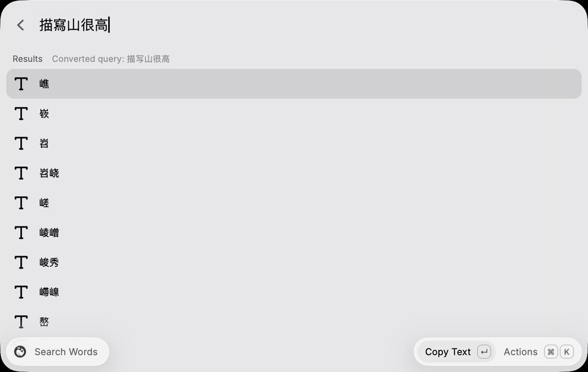
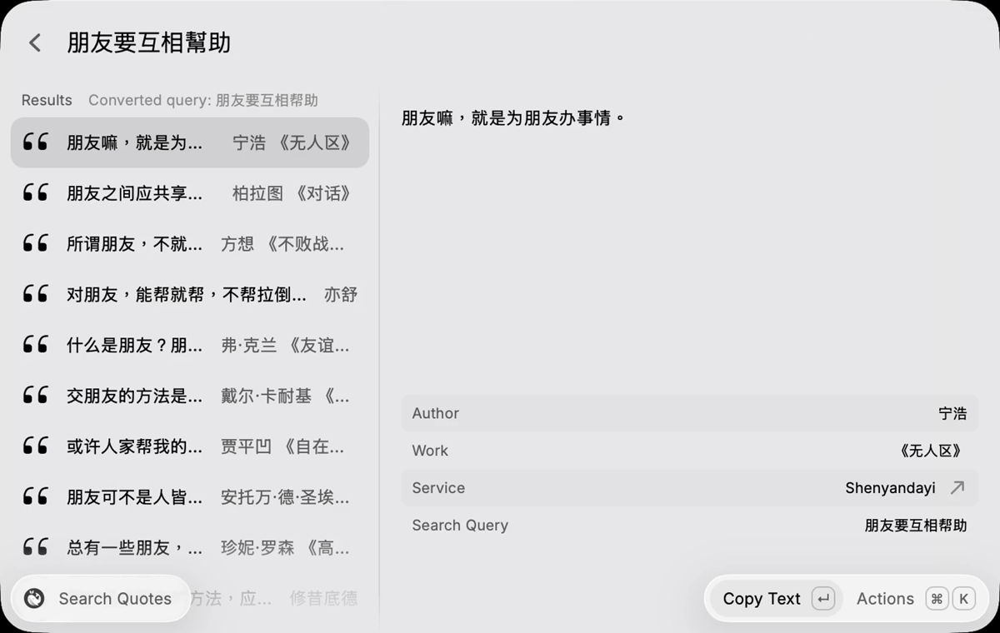

# 深言達意 · Tinycast / Raycast

在 Tinycast 或 Raycast 輸入一箇意思、情境或主題，直接搜尋中文詞語與佳句。結果在啟動器內顯示，覓句可以連作者與作品一起複製。資料來自[深言達意](https://www.shenyandayi.com/)。

[下載 Tinycast 安裝包](https://github.com/BaksiLi/shenyandayi-launcher/releases/latest/download/Shenyandayi-Tinycast.zip) · [觀看 21 秒操作示範](https://github.com/BaksiLi/shenyandayi-launcher/releases/download/v0.1.0/Shenyandayi-Raycast-screencast.mp4)

## 效果預覽

以下是 Raycast 英文版的實際畫面。Tinycast 版同樣會顯示結果，可另選繁體或簡體介面。

| 尋詞 · Search Words | 覓句 · Search Quotes |
| --- | --- |
|  |  |
| 輸入「描寫山很高」，找到「岧峣」「峻秀」等詞語。 | 輸入「朋友要互相幫助」，選取結果查看全文與出處。 |

## 在 Tinycast 安裝

1. 下載並解開 [`Shenyandayi-Tinycast.zip`](https://github.com/BaksiLi/shenyandayi-launcher/releases/latest/download/Shenyandayi-Tinycast.zip)。
2. 在 Tinycast 選 **Settings → Extensions → Add from folder**，選取解開的 `Shenyandayi` 資料夾。
3. 在啟動器搜尋 **Search Words** 或 **Search Quotes**。也可以搜尋「尋詞」或「覓句」。

Tinycast 會複製建置產物。匯入後可移除下載的資料夾。已裝過舊版時，重新匯入更新即可。

也可用 **Install from GitHub** 輸入 `BaksiLi/shenyandayi-launcher`，在本機從原始碼建置。此方式需要 Xcode、Node.js 與套件管理器。

## 結果顯示方式

按 Enter 後會在背景載入深言達意的公開結果頁，再顯示詞語清單或句子全文詳情。按 `⌘O` 可在預設瀏覽器開啟同一箇搜尋。

查詢由 macOS 內建 WebKit 在暫存訪客工作階段執行。擴充套件讀取頁面顯示的第一頁結果，保留原文和出處。網站改版或限制存取時，可使用瀏覽器備用動作。詳見 [SERVICE_INTEGRATION.md](SERVICE_INTEGRATION.md)。

## 在 Raycast 使用

可在已安裝 Raycast 的 Mac 上建置英文版，再用 `npm run dev` 載入。商店審查進度見 [Raycast PR #16372](https://github.com/raycast/extensions/pull/16372)。

Raycast 英文送審包與 Tinycast 三語版由同一份搜尋程式產生：

```sh
npm run prepare:raycast
cd build/raycast
npm ci --ignore-scripts
npm run build
npm run check
```

`build/raycast` 的 manifest、指令、設定、動作、錯誤訊息與 README 均使用英文；查詢文字仍可輸入中文。此資料夾是可獨立安裝與建置的來源包，不會使用根目錄的依賴。它沒有語言切換設定，也不包含中文介面資源。

送審進度與錄影流程見 [Raycast 送審記錄](RAYCAST_SUBMISSION.md)。

## 使用方式與設定

開啟「尋詞」或「覓句」，輸入描述，再按 Enter。新版不會在打字時連續發出請求，空白查詢不會送出。修改文字後，過期回應不會覆蓋目前畫面。中文、英文、引號、換行與網址特殊字元都會作為查詢文字處理。

在 Tinycast 的擴充套件設定中，新版的 **Interface Language / 介面語言 / 界面语言** 提供 **English (US)**、**繁體中文**、**简体中文**。指令內的提示、動作與錯誤訊息會切換；啟動器的靜態指令名稱及設定欄位不隨此偏好改名。

「搜尋前轉簡體」是尋詞、覓句共用的單一開關，預設開啟。只轉換查詢文字，關閉後送出原文；不轉換結果，也沒有另一箇轉換指令或方向選擇。OpenCC 轉換在本機執行。新版按 Enter 時，查詢文字會傳給深言達意；使用瀏覽器動作時會另將搜尋網址交給預設瀏覽器。本擴充套件不儲存查詢歷史或結果快取。

沿用原擴充套件 ID `deeplang`、指令 ID `wantwords` / `wantquotes` 與設定鍵 `useSystemOpencc`，以保留現有安裝的指令設定與轉換偏好；這個舊設定鍵現在控制內建 OpenCC，不再呼叫系統程式。

## 開發與來源

```sh
npm ci --ignore-scripts
npm run build
npm run check
npm run format:check
```

原始版本由 BaksiLi 開發，位於 [`BaksiLi/raycast-extensions` 的 `ext/deeplang` 分支](https://github.com/BaksiLi/raycast-extensions/tree/ext/deeplang/extensions/deeplang)，取自提交 `aca2701f8769412a9870fd54362ff0bbb480a74b`。本儲存庫將該擴充套件獨立維護。

已在 Tinycast 0.12.15 與 Raycast 2.12.1 實測兩箇指令的原生結果。詳見 [驗證記錄](VALIDATION.md)。

繁簡轉換使用 [`opencc-js`](https://github.com/nk2028/opencc-js) 的 `t2cn` 套件入口與 `t → cn` 設定。程式採 MIT 授權；內建 OpenCC 程式與字典的授權見 [THIRD_PARTY_NOTICES.md](THIRD_PARTY_NOTICES.md)。

本專案與深言達意、DeepLang AI、Tinycast、Raycast 均無隸屬關係。
